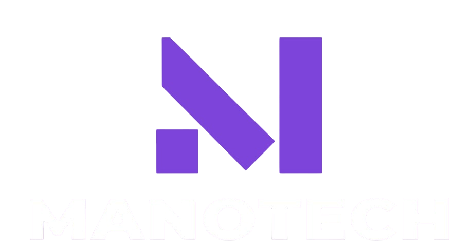
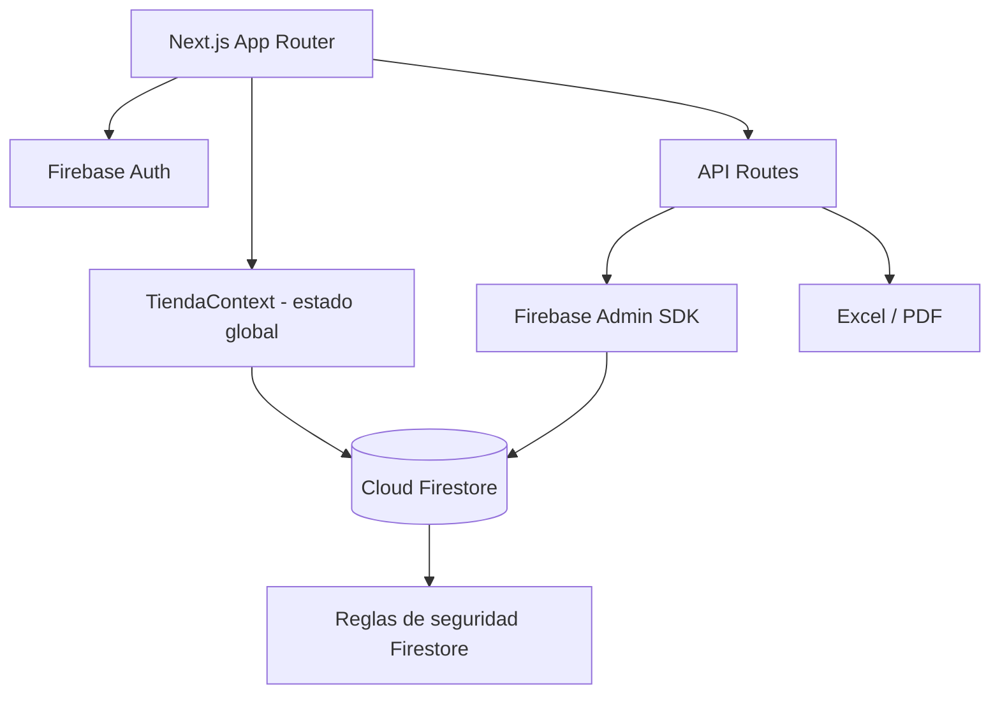

# MANOTECH · Panel Administrativo

**Sistema de gestión integral para tiendas de telefonía y accesorios tecnológicos**

  
  
  
  
  
  

---

## Visión general

**MANOTECH** es una plataforma administrativa de uso interno para el control operativo de una tienda de tecnología móvil. Centraliza inventario, ventas, caja, finanzas, historial y personal en una interfaz única, con sincronización en tiempo real sobre **Firebase Firestore** y control de acceso por roles.

El proyecto nace con una filosofía clara: **operaciones atómicas, trazabilidad contable y una experiencia de mostrador rápida**, tanto en escritorio como en tablet y móvil.

> [!NOTE]
> Este repositorio es de carácter privado. La documentación funcional y técnica completa vive en la bóveda de Obsidian del proyecto (`docs-obsidian`).

---

## Características principales

| Módulo | Capacidades |
| :--- | :--- |
| **Dashboard** | KPIs del día en USD y Bs, ganancia neta, transacciones, alertas de stock crítico, accesos rápidos y tasa BCV con caché offline. |
| **Inventario** | CRUD de productos con SKU, marca, categoría, costo, PVP y stock; buscador, filtros, paginación, cards de inversión/ganancia/total y exportación Excel/PDF. |
| **Ventas** | Carrito multi-producto con cliente, método de pago, descuentos por precio final y descuento de stock dentro de una transacción de Firestore. |
| **Caja** | Saldo por método (semanal o acumulado), retiros, gastos que descuentan de caja, cierres dominicales con arqueo y diferencia, exportación del cierre. |
| **Finanzas** | Ingresos, ganancia operativa, gastos por categoría y visualizaciones con Recharts (ventas diarias, métodos de pago y top de productos). |
| **Historial** | Bitácora de ventas y gastos, detalle tipo factura, anulación atómica con reposición de stock y exportación multiformato. |
| **Usuarios** | Alta, edición, bloqueo, cambio de rol y eliminación de cuentas; primer inicio con cambio de contraseña obligatorio. |
| **PWA** | Manifest, iconos, service worker y persistencia local de Firestore para tolerancia a cortes de red. |

---

## Stack tecnológico

| Capa | Tecnología |
| :--- | :--- |
| Frontend | Next.js 16 (App Router), React 19, TypeScript estricto |
| Estilos | Tailwind CSS v4 con tokens CSS y glassmorphism |
| Datos | Firebase Authentication + Cloud Firestore (SDK cliente y Admin SDK) |
| Gráficas | Recharts |
| Exportaciones | ExcelJS y jsPDF + AutoTable |
| Iconografía | Lucide React |
| Pruebas | Vitest + Testing Library + Firebase Rules Unit Testing |
| Despliegue | Vercel (cron deshabilitado hasta configurar backups) |

---

## Arquitectura

- **`src/app`**: rutas, layouts y endpoints (`/api/usuarios`, `/api/backup`, webhook de Sentry).
- **`src/components`**: módulos por dominio (inventario, finanzas, caja, usuarios, shared).
- **`src/context`**: sincronización en tiempo real con Firestore y acciones de negocio.
- **`src/services`**: inicialización de Firebase cliente/Admin y utilidades de Drive.
- **`src/utils`**: cálculos de caja, fechas, formatos y exportaciones.
- **`src/types`**: modelos de dominio en español y helpers de compatibilidad.

### Integridad transaccional

Las ventas y su anulación se ejecutan con `runTransaction`: se valida el stock, se descuenta o repone y se registra la venta en una sola operación atómica. Los cierres de caja son registros contables editables, pero **no eliminables**.

---

## Diseño · Violeta MANOTECH

La identidad visual se deriva directamente del logo de la marca.

| Token | Hex | Uso |
| :--- | :--- | :--- |
| Fondo principal | `#1D0D2A` | Fondo general de la aplicación |
| Superficie | `#2A1440` | Tarjetas, modales y barras |
| Acento primario | `#7D44DA` | Acciones, enlaces y foco |
| Texto primario | `#F5F0FA` | Títulos y datos clave |
| Texto secundario | `#B9A9CC` | Descripciones y fechas |
| Éxito | `#10B981` | Ingresos y ganancias |
| Aviso | `#FF9F43` | Stock crítico |
| Peligro | `#FF4949` | Gastos, errores y stock agotado |

Los tokens viven en `src/app/globals.css` y se consumen como utilidades de Tailwind (`bg-superficie`, `text-acento-primario`, etc.). El modo claro redefine únicamente los valores, manteniendo la misma semántica.

---

## Modelo de permisos

- **`admin`**: acceso total, incluida la gestión de usuarios y cierres contables.
- **`operador`**: acceso a inventario, ventas, caja, finanzas e historial.
- Los usuarios bloqueados se redirigen a `/bloqueado`.
- El primer inicio de un operador fuerza el cambio de contraseña en `/cambiar-contrasena`.

---

## Estado del proyecto

- Base funcional replicada y adaptada a la identidad **MANOTECH**.
- Entorno **dev** (`nanotech-dev-4d17d`) con administrador y catálogo de prueba.
- **Vercel Preview** aislado sobre el entorno `dev`, para revisar cambios sin afectar los datos reales de producción.
- Integraciones de Sentry/Telegram y backups a Google Drive **preparadas pero desactivadas** hasta configurar credenciales propias.
- Pendiente: validación funcional manual, endurecimiento de reglas y despliegue a producción.

---

  Desarrollado con Next.js, TypeScript y Firebase — MANOTECH

